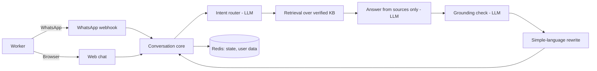

# KaamSathi

A multilingual, GenAI-powered assistant for gig and informal workers in India (delivery partners, drivers, daily-wage workers). It answers questions about welfare schemes and worker rights in simple language, with a source for every factual claim.

**Live demo:** https://kaamsathi-iota.vercel.app/
**Status:** Working prototype (see "What works today" and "Not built yet" below)

---

## The problem

Gig and informal workers often have low literacy, cheap phones, patchy data and many different languages. They are also frequent targets of scams and misinformation. An assistant for them must be simple, voice-friendly, available where they already are (WhatsApp), and above all **trustworthy**: it must never invent a scheme or a legal right.

## Approach

Design starts from the user's constraints, not from the AI:

- **Voice-first:** workers can speak instead of typing.
- **Multilingual:** English and Hindi, with mixed-language input (such as Hinglish) understood.
- **Short, simple replies:** brief, plain language, with buttons instead of typed commands.
- **Trust as the product:** facts come only from a verified knowledge base, never from the model's memory.

## What works today

| Capability | How it works |
|---|---|
| Language selection and consent | The first message asks for language and shows a plain-language consent notice. |
| Voice or text questions | Text is handled directly. Voice notes are transcribed by Gemini. |
| Schemes and rights answers | Retrieval over a verified knowledge base (`data/kb.json`), then an LLM answers using only the retrieved text. |
| Source citations | Every answer ends with the source name, link and the date it was last checked. |
| Refusal when unsure | If retrieval confidence is low, the assistant says it has no verified information instead of guessing. |
| Grounding check | A second LLM pass removes any sentence not supported by the retrieved text. |
| Simple-language rewrite | Answers are rewritten short and jargon-free. |
| Privacy commands | `MENU`, `HELP`, `LANGUAGE` and `DELETE MY DATA` are available. Users are identified by a salted hash, not a phone number. |
| Web chat | A phone-style web chat runs the same engine, for demos and testing. |
| WhatsApp channel (code) | A WhatsApp Cloud API webhook is implemented: signature verification, duplicate-message protection, text, voice, image and button handling. **It is not yet connected to a live WhatsApp number.** |

## Not built yet

These are planned but not implemented in this prototype:

- Eligibility checker (rules engine for scheme matching)
- Grievance and complaint drafting, with human-help handoff
- Earnings tracker with plain-language weekly insights
- Document help (photo to simple explanation)
- Safety checklists and SOS helper
- Tamil and other languages
- Voice replies (text to speech), weekly push messages, offline mode
- Automated evaluation suite for trap questions and prompt injection

## Where GenAI is used

1. **Intent routing:** classifies what the worker is asking for.
2. **Transcription:** turns voice notes into text.
3. **Retrieval-augmented answers:** writes answers strictly from retrieved, verified sources.
4. **Grounding check:** a second pass that removes unsupported claims.
5. **Simplification:** rewrites answers into short, plain language in the user's language.

## How trust is enforced

- Facts about schemes and rights come **only** from the knowledge base.
- Every answer carries a citation (source, link, last checked date).
- Low retrieval confidence leads to "I don't have verified information on this."
- The assistant never presents itself as a lawyer.
- User text, transcripts and image text are treated as data, never as instructions.

The knowledge base is only as good as its entries. Each entry records its official source URL and the date it was last checked. Details should be re-verified against the source before relying on them, because scheme rules change.

## Architecture



- **Framework:** Next.js (App Router, TypeScript), deployed on Vercel
- **LLM:** Gemini, behind a provider interface
- **Storage:** Upstash Redis for conversation state and user data, with expiry times
- **Channels:** WhatsApp Cloud API webhook and a web chat, both thin adapters over one core

## Privacy

- WhatsApp message content passes through Meta and this server. Conversations are not end-to-end private from the service.
- Users are identified by a salted hash of the phone number. Phone numbers are not stored.
- Message content is not logged. Photos and voice notes are processed in memory and not stored.
- Stored data is limited to language choice and conversation state.
- A user can send `DELETE MY DATA` to remove everything stored under their hashed id.

## Run locally

```bash
git clone https://github.com/abhi0syal/kaamsathi.git
cd kaamsathi
npm install
cp .env.example .env.local   # then fill in the values
npm run dev
```

Open http://localhost:3000.

### Environment variables

| Name | Purpose |
|---|---|
| `GEMINI_API_KEY` | Gemini API access |
| `GEMINI_MODEL` | Gemini model name |
| `UPSTASH_REDIS_REST_URL` | Redis REST URL |
| `UPSTASH_REDIS_REST_TOKEN` | Redis REST token |
| `WHATSAPP_TOKEN` | WhatsApp Cloud API access token |
| `WHATSAPP_PHONE_NUMBER_ID` | WhatsApp sender number id |
| `WHATSAPP_VERIFY_TOKEN` | Secret you choose, entered in Meta's webhook settings |
| `WHATSAPP_APP_SECRET` | Used to verify webhook signatures |
| `USER_HASH_SALT` | Secret salt for hashing user ids |

Never commit real values. `.env.local` is git-ignored.

### Tests

```bash
npm test
```

## Connect WhatsApp (optional)

1. Create a Meta developer app and add the WhatsApp product.
2. Set the webhook callback URL to `https://<your-domain>/api/whatsapp/webhook` and the verify token to your `WHATSAPP_VERIFY_TOKEN`.
3. Subscribe to the `messages` field.
4. Add your phone as a test recipient, then message the test number.

## Known limitations

- Prototype scope: only the schemes-and-rights module is complete.
- The knowledge base is small and must be verified against official sources before real use.
- Answers are in English and Hindi only.
- The WhatsApp test number only serves pre-registered recipients.
- Not legal advice. For legal disputes, workers should contact a labour office, legal-aid service or an NGO.

## License

MIT
